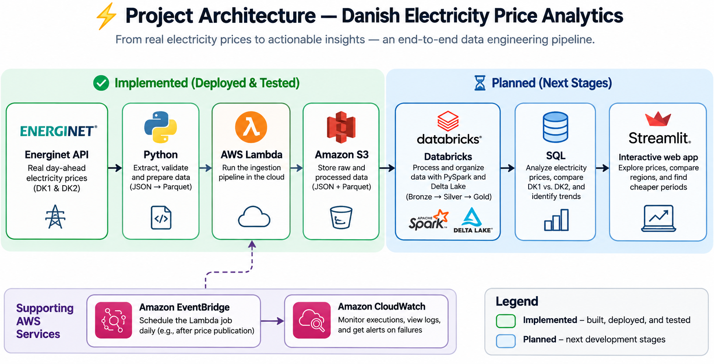

# ⚡ Danish Electricity Price Analytics 🇩🇰

An end-to-end data engineering project built to support **recurring, ongoing reports on Danish electricity prices** using real day-ahead data from Energinet. The pipeline collects and validates prices for **DK1 (Western Denmark)** and **DK2 (Eastern Denmark)**, stores them in Amazon S3, and is being extended with a **Databricks medallion architecture** for reporting and analytics.

The goal is to keep reports up to date as new prices arrive: compare regions, track price patterns over time, and identify cheaper periods through reusable SQL analysis and an interactive Streamlit app. Historical storage, repeatable transformations, and consistent quality checks provide the foundation for reliable reporting across successive days, weeks, and months.

**Current stage:** Building the **Bronze → Silver → Gold** structure in Databricks using PySpark and Delta Lake.

## 📍 Project Status

| Stage | Status |
|---|---|
| Explore the Energinet API and validate initial data | Completed |
| Prepare JSON and Parquet datasets | Completed |
| Upload raw and processed data to Amazon S3 | Completed |
| Build the daily ingestion script | Completed |
| Deploy and manually test AWS Lambda | Completed — tested on 14 November 2026 |
| Build the Databricks medallion structure | In progress |
| Develop reusable SQL analytics and recurring reports | Planned |
| Build the Streamlit app | Planned |
| Document EventBridge scheduling and CloudWatch monitoring | Configuration still to verify |

## 🗺️ Architecture

```text
Energinet API
    ↓
Python ingestion on AWS Lambda
    ↓
Amazon S3 — raw JSON + prepared Parquet
    ↓
Databricks / PySpark / Delta Lake          ← Current work
    Bronze → Silver → Gold
    ↓
SQL analytics and recurring reports      ← Planned
    ↓
Streamlit app                            ← Planned
```



The architecture image shows the overall project design. The status table above reflects current progress: ingestion and S3 storage are implemented, and the Databricks layer is under construction. EventBridge scheduling and CloudWatch monitoring still need configuration verification and documentation.

## 🛠️ Technology Stack

| Area | Technologies | Status |
|---|---|---|
| Extraction and preparation | Python, Requests, Pandas, PyArrow | Implemented |
| Storage and cloud execution | Amazon S3, AWS Lambda, Boto3 | Implemented |
| Data formats | JSON, Parquet | Implemented |
| Lakehouse processing | Databricks, PySpark, Delta Lake | In progress |
| Analytics and recurring reporting | SQL | Planned |
| Visualization | Streamlit | Planned |
| Scheduling and monitoring | EventBridge, CloudWatch | To verify and document |
| Version control | Git, GitHub | In use |

## 🔄 Data Pipeline

### 1. Extract and validate prices

The initial exploration in [`scripts/api_data_extraction.ipynb`](scripts/api_data_extraction.ipynb) uses Energinet's `DayAheadPrices` dataset for DK1 and DK2. It checks missing values, duplicates, price areas, price types, timestamps, and missing 15-minute intervals.

The initial dataset contains **1,344 records covering 1–7 November 2026**, with the implemented quality checks passing.

### 2. Prepare and store data

[`scripts/data_preparation.ipynb`](scripts/data_preparation.ipynb) prepares timestamps and delivery dates and exports Parquet while preserving the original price precision. [`scripts/aws_s3_integration.ipynb`](scripts/aws_s3_integration.ipynb) uploads the original JSON and prepared Parquet to S3.

The daily pipeline uses this layout:

```text
s3://nordic-energy-data-pipeline-yh2026/
├── raw/dayaheadprices/delivery_date=YYYY-MM-DD/prices.json
└── processed/dayaheadprices/delivery_date=YYYY-MM-DD/day_ahead_prices.parquet
```

The earlier notebook uploads use `ingestion_date=YYYY-MM-DD` partitions instead of `delivery_date=YYYY-MM-DD`. These existing S3 paths are ingestion outputs; the Databricks medallion layers are the current development stage.

### 3. Run ingestion through AWS Lambda

[`scripts/energy_pipeline.py`](scripts/energy_pipeline.py) combines extraction, validation, JSON/Parquet output, and optional S3 upload. It:

- Calculates tomorrow's delivery date in the `Europe/Copenhagen` timezone.
- Validates complete DK1/DK2 coverage, with **96 quarter-hour observations per area** on normal days and **92 or 100** on daylight saving transition days.
- Retries transient API failures and incomplete responses.
- Preserves the raw API response alongside prepared Parquet.
- Supports safe retries and rejects conflicting S3 overwrites.

The pipeline was deployed to **AWS Lambda and manually tested successfully on 14 November 2026**. Lambda authenticates through an IAM execution role. See [AWS setup and deployment notes](docs/AWS_SETUP.md) for the documented configuration.

### 4. Build the Databricks medallion structure — in progress

The current work organizes S3 data into Delta Lake tables with three layers:

| Layer | Intended role |
|---|---|
| **Bronze** | Ingest source data from S3 and retain source records for downstream processing. |
| **Silver** | Apply consistent types, clean and validate records, and handle duplicates for reliable DK1/DK2 price data. |
| **Gold** | Prepare reusable reporting tables and summaries for recurring regional comparisons, price trends, and cheaper-period analysis. |

Databricks notebooks and table definitions will be added to this repository as the implementation progresses.

### 5. Produce recurring reports and visualize results — planned

Reusable SQL queries will use the Gold layer to produce ongoing reports comparing DK1 and DK2, tracking price trends, and identifying cheaper periods. The intended workflow will refresh reporting tables as new data arrives, so the same reporting logic can run consistently over an expanding history. Report scheduling and refresh orchestration remain to be implemented.

A Streamlit app will provide access to the latest reporting results and interactive historical exploration. Any savings estimates will need to distinguish spot prices from the customer's total electricity cost, including tariffs and contract terms.

## 🚀 Getting Started

The local setup runs the Python ingestion pipeline. Databricks processing is being built separately in the workspace.

```bash
git clone https://github.com/Yassdata/Nordic-energy-data-pipeline.git
cd Nordic-energy-data-pipeline
python3.12 -m venv .venv
source .venv/bin/activate
python -m pip install -r requirements.txt
```

The pinned dependencies in [`requirements.txt`](requirements.txt) were verified for Python 3.12.

### Run locally

Fetch tomorrow's data and write it locally:

```bash
scratch="$(mktemp -d)"
python -B scripts/energy_pipeline.py --local-output "$scratch/output"
```

To use a saved, complete single-day API response:

```bash
scratch="$(mktemp -d)"
python -B scripts/energy_pipeline.py \
  --input-json /path/to/single-day-response.json \
  --delivery-date YYYY-MM-DD \
  --local-output "$scratch/output"
```

### Upload to S3

With valid AWS authentication configured:

```bash
export AWS_PROFILE=nordic-energy
export ENERGY_S3_BUCKET=nordic-energy-data-pipeline-yh2026
python -B scripts/energy_pipeline.py --upload
```

Local development can use the named AWS profile; Lambda uses its IAM execution role. See [AWS Setup](docs/AWS_SETUP.md).

## 🧪 Testing and Data Quality

Run the automated ingestion tests:

```bash
python -B -m unittest discover -s tests -v
```

The tests cover Copenhagen delivery dates, daylight saving transitions, missing and duplicate intervals, invalid prices and areas, retry behavior, local JSON/Parquet output, Lambda uploads, and S3 overwrite safeguards.

## 📁 Repository Structure

```text
├── scripts/
│   ├── api_data_extraction.ipynb   # Initial API exploration and checks
│   ├── data_preparation.ipynb     # Timestamp preparation and Parquet export
│   ├── aws_s3_integration.ipynb   # Initial S3 uploads
│   └── energy_pipeline.py        # CLI and Lambda ingestion pipeline
├── tests/
│   └── test_energy_pipeline.py
├── json_data_file/                # Local raw data
├── data/processed/                # Local prepared data
├── docs/
│   └── AWS_SETUP.md
├── PROJECT_ARCHITECTURE.png
├── requirements.txt
└── README.md
```

## 📊 What's Next?

1. **Finish the Databricks medallion structure:** Build and validate Bronze, Silver, and Gold Delta tables with PySpark.
2. **Add Databricks work to the repository:** Document S3 access, table definitions, transformations, and data quality checks.
3. **Develop recurring reports:** Create reusable SQL queries for DK1/DK2 comparisons, price trends, and cheaper periods, and implement reporting refreshes as new data arrives.
4. **Build the Streamlit app:** Present the latest reports and make historical comparisons and price exploration interactive.

A documentation follow-up remains to verify and record EventBridge scheduling and CloudWatch monitoring.

## 🌍 Future Possibilities

Expand beyond Denmark to compare electricity prices across other Nordic countries.

## 📚 Data Source

[Energinet — Energi Data Service](https://www.energidataservice.dk/), using the `DayAheadPrices` dataset for DK1 and DK2.
