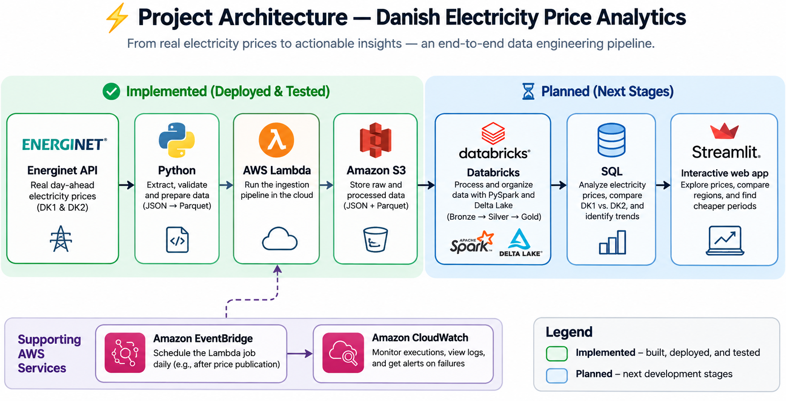

# ☁️ AWS Setup — Danish Electricity Price Analytics

This document records how I configured AWS for the electricity-price ingestion pipeline, from local authentication to Amazon S3 and AWS Lambda.

## 1. AWS CLI on macOS

I installed AWS CLI v2 locally on my Mac and configured my shell PATH. To verify the installation:

```bash
aws --version
```

## 2. AWS Authentication

I used AWS CLI login with my AWS Builder ID and a named profile, rather than placing access keys in source code:

```bash
aws login --profile nordic-energy
aws sts get-caller-identity --profile nordic-energy
```

The second command verified the authenticated AWS identity. Local AWS configuration is stored outside the repository, typically under `~/.aws/config`.

## 3. Amazon S3 Bucket

| Setting | Value |
|---|---|
| Bucket | `nordic-energy-data-pipeline-yh2026` |
| Region | `eu-north-1` (Stockholm) |
| Public access | Blocked |
| ACLs | Disabled |
| Encryption | SSE-S3 |
| Versioning | Disabled |

Raw API JSON and processed Parquet are stored separately. The initial notebook uploads use ingestion-date prefixes:

```text
raw/dayaheadprices/ingestion_date=YYYY-MM-DD/prices.json
processed/dayaheadprices/ingestion_date=YYYY-MM-DD/day_ahead_prices.parquet
```

## 4. Python Connection with Boto3

For local development, Boto3 uses the named AWS profile:

```python
import boto3

session = boto3.Session(
    profile_name="nordic-energy",
    region_name="eu-north-1",
)
s3 = session.client("s3")
s3.head_bucket(Bucket="nordic-energy-data-pipeline-yh2026")
print("Successfully connected to S3!")
```

I tested the S3 connection and uploaded the initial JSON and Parquet datasets using `scripts/aws_s3_integration.ipynb`.

## 5. Daily Pipeline

`scripts/energy_pipeline.py` combines extraction, completeness checks, JSON/Parquet preparation and optional S3 upload. It calculates the next delivery date in the `Europe/Copenhagen` timezone and handles days with 92, 96 or 100 quarter-hour intervals per price area.

Automated runs use delivery-date prefixes:

```text
raw/dayaheadprices/delivery_date=YYYY-MM-DD/prices.json
processed/dayaheadprices/delivery_date=YYYY-MM-DD/day_ahead_prices.parquet
```

The upload logic checks existing objects to prevent accidental overwrites and support safe retries.

## 6. AWS Lambda Deployment

I deployed the ingestion script to AWS Lambda and **successfully tested it on 14 November 2026**. The Python entry point is `scripts.energy_pipeline.lambda_handler` when packaged from the repository root.

The Lambda environment uses the destination bucket setting:

```text
ENERGY_S3_BUCKET=nordic-energy-data-pipeline-yh2026
```

The deployed function uses its **IAM execution role** rather than a local CLI profile or hardcoded access keys. The exact Lambda function name, package/deployment commands, and role name should be added after checking the deployed configuration; they are not guessed here.

## 7. IAM Permissions and Security

The ingestion role needs S3 permissions appropriate to the script's object checks and uploads, such as `s3:GetObject` and `s3:PutObject`, scoped to the relevant bucket paths. CloudWatch logging permissions are also needed for Lambda execution logs.

Security choices include blocked public S3 access, disabled ACLs, SSE-S3 encryption, and credentials kept out of GitHub. Bucket versioning was not enabled.

## 8. Scheduling and Monitoring

**Confirmed:** Lambda was deployed and manually tested successfully.

**Still to verify and document:** Whether EventBridge Scheduler is configured for daily invocation; its schedule, timezone and trigger; CloudWatch log output; and any failure alerting. These are not claimed as completed.

## 9. Architecture and Next Steps



The deployed AWS layer handles **Energinet API → Python on Lambda → S3**. Planned work will read the stored data into **Databricks/PySpark/Delta Lake (Bronze → Silver → Gold)**, run **SQL analytics**, and present results through **Streamlit**.

Return to the [main README](../README.md).
